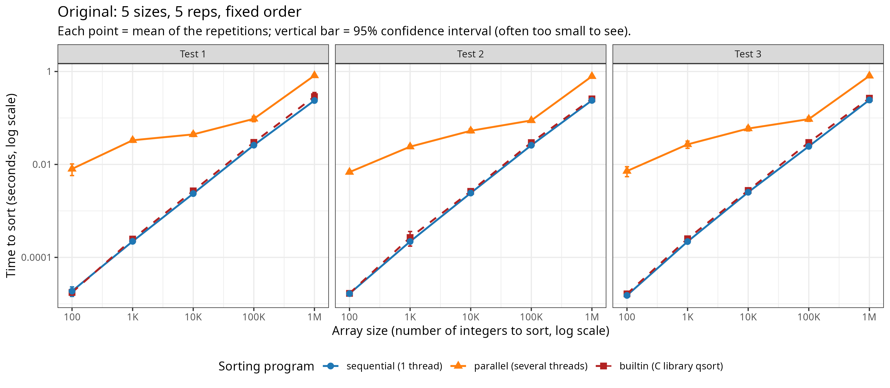
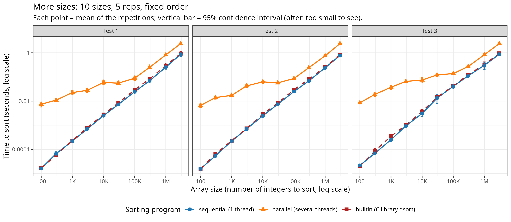
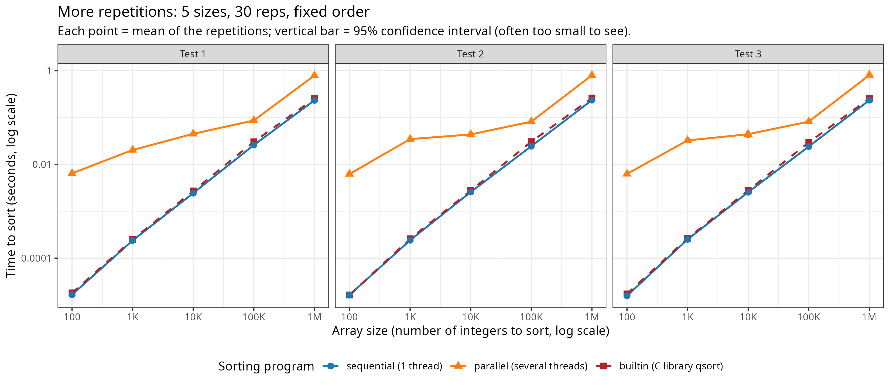
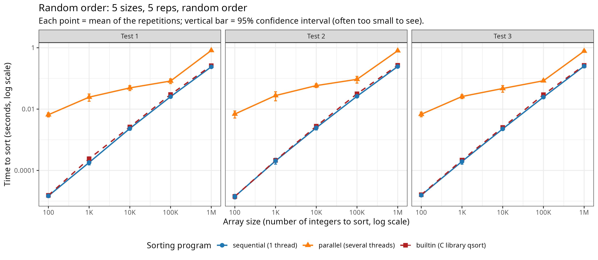
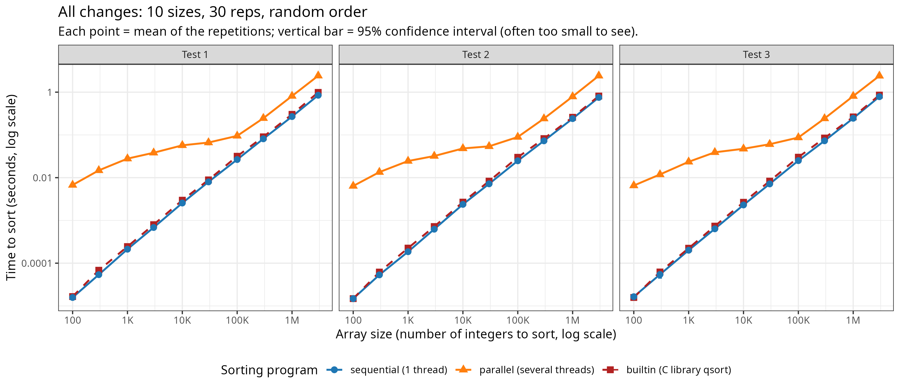
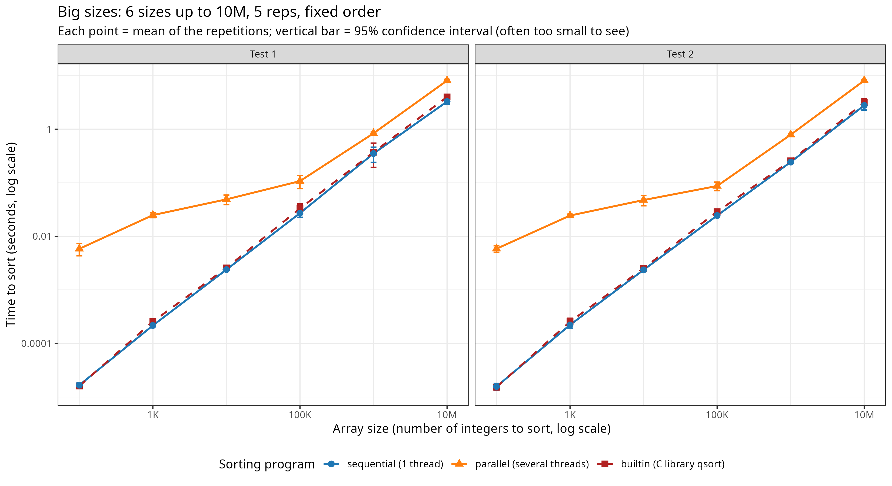
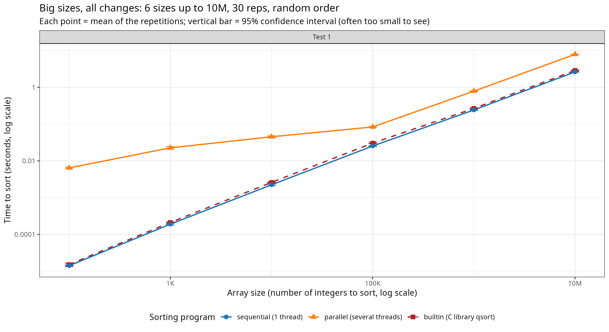
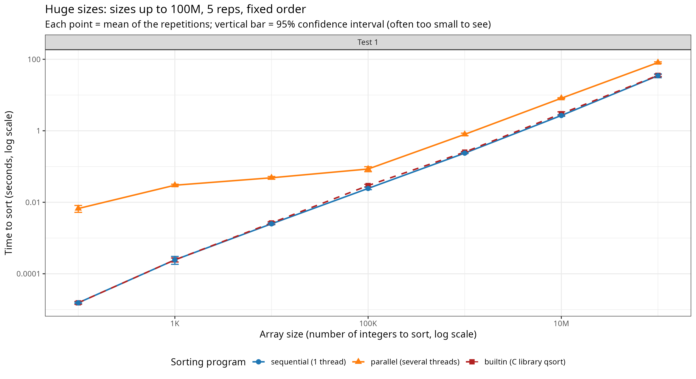
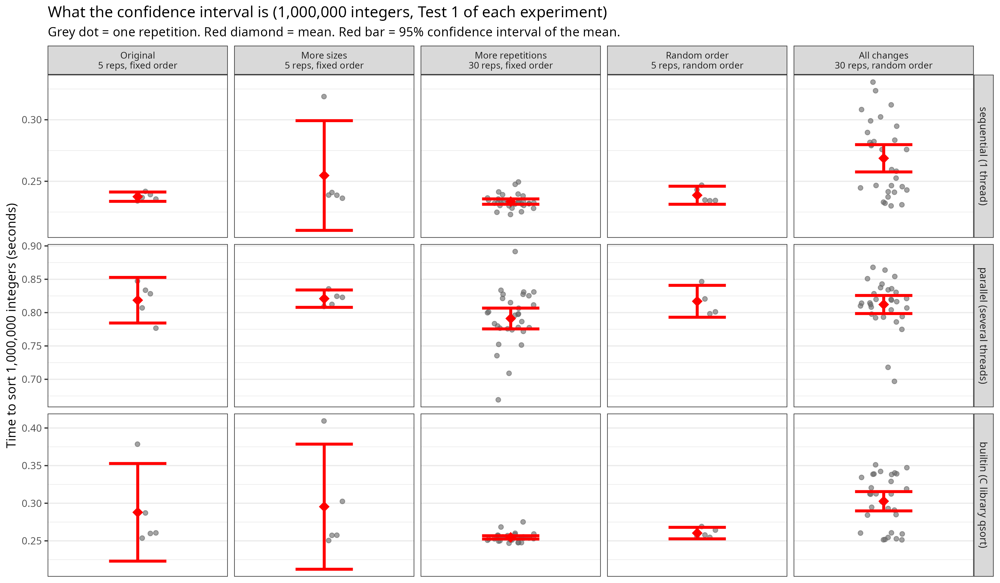

# Parallel Quicksort: laboratory notebook

## Setup

- Machine: personal laptop
- CPU: 13th Gen Intel Core i5-1340P, 16 logical CPUs (`nproc` = 16)
- OS: Ubuntu, Linux kernel 7.0.0-34-generic, x86_64
- Compiler: gcc 15.2.0

## First single run

First I ran the code once: `./src/parallelQuicksort 1000000`

I got:

```
Sequential: 0.259 s
Parallel:   0.805 s   <- 3x slower
Built-in:   0.274 s
```

But a single run can not prove the result yet.

## The original design and its weaknesses

After reading the author's journal and code, this is what the original code does:

- 5 sizes: 100 to 1,000,000
- 5 repetitions each
- runs them in a fixed order, so all the 100s first, then all the 1000s, and so on
- appends the output to a text file, which a Perl script turns into CSV, then plotted

I think the weaknesses of the design are: few repetitions, fixed order, only 5 sizes, and no confidence interval.

## Baseline: running the original script

I ran the experiment script as it is: `bash scripts/run_benchmarking.sh`

Rough numbers of this first run (rounded by eye, the exact numbers are in `data/liya_2026-11-04/analysis_output.txt`):

| size | Sequential | Parallel |
|---|---|---|
| 100 | 0.00002 s | 0.007 s |
| 10,000 | 0.0025 s | 0.05 s |
| 1,000,000 | 0.26 s | 0.79 s |

The author's journal says that at 1,000,000 elements parallel takes 0.16 s and sequential 0.23 s, so parallel is faster, and he writes that parallel is worth it for arrays larger than 400,000.

On my laptop at 1,000,000 elements parallel takes 0.81 s and sequential 0.27 s, so parallel is 3 times slower.

So the author's claim is not valid on my laptop.

Possible reasons: different hardware, gcc and Linux versions

## Experiments design 1

Based on the weaknesses above, I designed 4 experiments. I change one factor at a time, and then all factors together. I call them Experiment 1 to 4 here. In the figures, "Test 1, 2, 3" means the three runs of the same experiment.

### Experiment 1: change the sizes

Main change in the code: 10 sizes

```bash
touch $OUTPUT_FILE
for i in 100 300 1000 3000 10000 30000 100000 300000 1000000 3000000 ; do
    for rep in `seq 1 5`; do
        echo "Size: $i" >> $OUTPUT_FILE;
        ./src/parallelQuicksort $i >> $OUTPUT_FILE;
    done ;
done
```

### Experiment 2: change the repetitions

Main change in the code: 30 repetitions

```bash
touch $OUTPUT_FILE
for i in 100 1000 10000 100000 1000000; do
    for rep in `seq 1 30`; do
        echo "Size: $i" >> $OUTPUT_FILE;
        ./src/parallelQuicksort $i >> $OUTPUT_FILE;
    done ;
done
```

### Experiment 3: change the order to random

Main change in the code:

```bash
touch $OUTPUT_FILE
for i in 100 1000 10000 100000 1000000; do
for rep in `seq 1 5`; do
echo $i
done
done | shuf | while read i; do
echo "Size: $i" >> $OUTPUT_FILE;
./src/parallelQuicksort $i >> $OUTPUT_FILE;
done
```

### Experiment 4: change all conditions

Main change in the code:

```bash
touch $OUTPUT_FILE
for i in 100 300 1000 3000 10000 30000 100000 300000 1000000 3000000; do
for rep in `seq 1 30`; do
echo $i
done
done | shuf | while read i; do
echo "Size: $i" >> $OUTPUT_FILE;
./src/parallelQuicksort $i >> $OUTPUT_FILE;
done
```

### Running and converting

I ran every script three times and the original script too, and changed the output from txt to csv files with the Perl script given by the author:

```bash
cd ~/M2R-ParallelQuicksort/data/liya_2026-11-04
for f in *.txt; do
  perl ../../scripts/csv_quicksort_extractor.pl < "$f" > "${f%.txt}.csv"
done
ls
cd ../..
```

Then I analysed everything with `scripts/analyze.R` and plotted it with ggplot:

```bash
Rscript scripts/analyze.R > data/liya_2026-11-04/analysis_output.txt 2>&1
```

| Experiment | Script | Sizes | Reps | Order |
|---|---|---|---|---|
| Original | run_benchmarking.sh | 5 | 5 | fixed |
| More sizes | run_benchmarking_size.sh | 10 | 5 | fixed |
| More repetitions | run_benchmarking_reps.sh | 5 | 30 | fixed |
| Random order | run_benchmarking_random.sh | 5 | 5 | random |
| All changes | run_benchmarking_all.sh | 10 | 30 | random |

Data are in `data/liya_2026-11-04`, the analysis script is `scripts/analyze.R`.

## Results

In every figure below: x axis = array size (number of integers to sort), y axis = time to sort in seconds, both in log scale. Blue = sequential (1 thread), orange = parallel (several threads), dark red = built-in C `qsort`. Test 1, 2, 3 = the three runs of the same script.

### Original (5 sizes, 5 repetitions, fixed order)



### More sizes (10 sizes, 5 repetitions, fixed order)



### More repetitions (5 sizes, 30 repetitions, fixed order)



### Random order (5 sizes, 5 repetitions, random order)



### All changes (10 sizes, 30 repetitions, random order)



### Parallel time / sequential time (from analysis_output.txt)

- 100 integers: about 380-490 times slower
- 1,000,000 integers: about 2.8-3.5 times slower
- 3,000,000 integers (the experiments with 10 sizes): about 2.8-3.2 times slower

The parallel program was never faster. The three tests of each experiment agree.

## Intermediate conclusion

On my laptop the claim that the parallel version saves time is not supported: it was slower at every size I tested, up to 3,000,000 integers. The journal found the parallel version faster at 1,000,000 integers, so the result depends on the machine.

Limitations: only one machine, only sizes up to 3,000,000.

Next: repeat on my groupmate's (Tom Laucournet) machine 

============================================================================================

## Experiments design 2

### Bigger sizes (after discussion with my groupmate)

After discussing with groupmate, he thinks that my design of experiments needs bigger size, because so far parallel version has no advantages. Maybe the parallel version only wins when the array is much bigger. So I will try with bigger size.

### Experiment 5: much bigger sizes (run_benchmarking_bigsize.sh)

Main change in the code: sizes up to 10,000,000, 5 repetitions, fixed order. I ran this script two times (Test 1, Test 2).

```bash
touch $OUTPUT_FILE
for i in 100 1000 10000 100000 1000000 10000000 ; do
for rep in `seq 1 5`; do
echo "Size: $i" >> $OUTPUT_FILE;
./src/parallelQuicksort $i >> $OUTPUT_FILE;
done ;
done
```

### Experiment 6: much bigger sizes with more reps and random order (run_benchmarking_bigsizewithall.sh)

Main change in the code: sizes up to 10,000,000, 30 repetitions, random order. I ran this script one time.

```bash
touch $OUTPUT_FILE
for i in 100 1000 10000 100000 1000000 10000000 ; do
for rep in `seq 1 30`; do
echo $i
done
done | shuf | while read i; do
echo "Size: $i" >> $OUTPUT_FILE;
./src/parallelQuicksort $i >> $OUTPUT_FILE;
done
```

### Experiment 7: 100,000,000 integers (run_benchmarking_bigbigsize.sh)

Main change in the code: one more size, 100,000,000 integers (400 MB for one array), 5 repetitions, fixed order. I ran this script one time. I did not do 30 repetitions here, because 30 repetitions would take too long.

```bash
touch $OUTPUT_FILE
for i in 100 1000 10000 100000 1000000 10000000 100000000 ; do
for rep in `seq 1 5`; do
echo "Size: $i" >> $OUTPUT_FILE;
./src/parallelQuicksort $i >> $OUTPUT_FILE;
done ;
done
```

The data are in `data/liya_2026-11-04_big`, the analysis script is `scripts/analyze_big.R` same figures as before: three programs in one panel, time in seconds, log scales.

### Results of the bigger sizes

Experiment 5 (up to 10M, 5 repetitions, fixed order):



Experiment 6 (up to 10M, 30 repetitions, random order):



Experiment 7 (up to 100M, 5 repetitions, fixed order):



Parallel time / sequential time (from analysis_big_output.txt):

| size | Exp 5 Test 1 | Exp 5 Test 2 | Exp 6 | Exp 7 |
|---|---|---|---|---|
| 100 | 352 | 375 | 459 | 434 |
| 1,000 | 115 | 110 | 119 | 122 |
| 10,000 | 20.5 | 20.2 | 20.3 | 19.4 |
| 100,000 | 4.0 | 3.6 | 3.3 | 3.5 |
| 1,000,000 | 2.4 | 3.2 | 3.3 | 3.4 |
| 10,000,000 | 2.5 | 2.9 | 3.0 | 3.0 |
| 100,000,000 | - | - | - | 2.3 |


### Observations of the bigger sizes

- The parallel version is still slower at every size, also at 10,000,000 and at 100,000,000. So bigger size alone does not make the parallel version faster on my laptop.
- The ratio becomes smaller when the size is bigger: about 3.3 at 1,000,000, about 3.0 at 10,000,000 and 2.3 at 100,000,000. But the 100,000,000 point is only one run with 5 repetitions, and the sequential times of the 5 repetitions are quite different. 

- My groupmate (Tom) looked at my curves and said that after about 10^6 the sequential and the parallel curves become parallel, so it seems that my computer stops gaining parallel performance, while on his machine the two curves are the same as mine until 10^6, but after that his parallel curve continues to improve and gets better than the sequential one.

## Intermediate conclusion

On my laptop the claim that the parallel version saves time is not supported: it was slower at every size I tested, even up to 100,000,000 integers. 

The ratio parallel / sequential goes down slowly with the size, about 3.3 at 1M, 3.0 at 10M, 2.3 at 100M, so I cannot say that the parallel version will never win at bigger sizes, but I did not test it.

Limitations: only sizes up to 100,000,000 and only one run and 5 repetitions at this biggest size.

===================================================================

## Is it my computer or the code?

Based on the results so far, I wanted to check if the problem comes from my computer or from the code. So I did two more tests:

1. I cloned Tom's code and ran it on my computer.
2. I ran my own code on a friend's computer.

I got interesting results:

- Tom's code on my computer did not give the same result as on his computer. The parallel performance is still bad.
- My own code on my friend's computer: at size 10,000,000 the parallel version starts to be faster than the sequential one.

So I think the problem comes from my computer, not from the code.

### Configuration of the three computers

| | My laptop | Tom's laptop | My friend's laptop |
|---|---|---|---|
| CPU | 13th Gen Intel Core i5-1340P | AMD Ryzen 7 7840HS | Intel Core i7-7500U @ 2.70GHz |
| Cores / threads | 12 cores (4 performance + 8 efficiency) / 16 threads | 8 cores / 16 threads | 2 cores / 4 threads |
| OS | Ubuntu 26.04.1 LTS, kernel 7.0.0-42-generic | Ubuntu | Ubuntu 24.04.4 LTS |

### Test 1: Tom's code on my computer

I ran Tom's benchmark script (4 experiments: original, more sizes, more repetitions, random order). I removed the size 30,000,000 because it takes too long, so the biggest size is 10,000,000. I plotted the results with Tom's analysis script.

Data: `data/liya_2026-11-10-DataFromTomCode`

Mean times at 10,000,000 integers:

| experiment | reps | Sequential | Parallel | Parallel / sequential |
|---|---|---|---|---|
| original | 5 | 2.75 s | 8.09 s | 2.9 |
| more sizes | 5 | 2.90 s | 8.18 s | 2.8 |
| more repetitions | 30 | 3.08 s | 8.09 s | 2.6 |
| random order | 5 | 2.70 s | 7.84 s | 2.9 |

In Tom's notebook, one run of the same code on his computer at 10,000,000 gives 3.10 s for sequential and 1.76 s for parallel. On my computer parallel is about 3 times slower, while my sequential time is similar to Tom's. So only the parallel part is slow on my computer.

### Test 2: my code on my friend's computer

I ran my script `run_benchmarking_bigsizewithall.sh` (Experiment 6: sizes up to 10,000,000, 30 repetitions, random order) on my friend's computer. I did not plot this data, I only computed the means from the txt file.

Data: `data/verona_2026-11-10-DatafromOther/measurements_bigsizewithall_22_03.txt`

| size | Sequential | Parallel | Parallel / sequential | runs where parallel is faster |
|---|---|---|---|---|
| 100 | 0.00001 s | 0.0073 s | 716 | 0 / 30 |
| 10,000 | 0.0016 s | 0.054 s | 34 | 0 / 30 |
| 100,000 | 0.0185 s | 0.076 s | 4.1 | 0 / 30 |
| 1,000,000 | 0.215 s | 0.209 s | 0.97 | 24 / 30 |
| 10,000,000 | 2.49 s | 1.77 s | 0.71 | 30 / 30 |

On my friend's computer, the parallel version is about as fast as the sequential one at 1,000,000 integers, and faster in all 30 runs at 10,000,000 integers (about 30 % faster). On my computer, with the same code, parallel is about 3 times slower at 10,000,000.

My friend's computer is older and has only 2 cores (4 threads), but the parallel version is faster there. My laptop has 12 cores (16 threads), but the parallel version is slower. So the problem is not the number of cores.


==========================================================================================

## Improving the analysis

### Confidence intervals

At first the confidence intervals were not visible in my plots, because they are too small on a log scale. So I made one more figure that shows them: only 1,000,000 integers, Test 1 of each experiment.



Figure: every repetition (grey dot), the mean (red diamond) and its 95% confidence interval (red bar), for 1,000,000 integers, Test 1 of each experiment. With 5 repetitions a single slow run can stretch the interval a lot (for example the built-in qsort in "More sizes"). With 30 repetitions the interval is much shorter, so the mean is more reliable. Each row has its own y axis, so compare bar lengths only within a row.

Average width of the 95% CI (% of the mean), from analysis_output.txt:

| Experiment | Width |
|---|---|
| Original | 9.9 |
| More sizes | 11.6 |
| More repetitions | 4.4 |
| Random order | 12.5 |
| All changes | 5.0 |

With 30 repetitions the interval is about half as wide as with 5.

### Other observations

- Random order: with 5 repetitions, I see no clear difference with the fixed order (for example about 3.1-3.4 at 1,000,000 integers in both). But 5 repetitions may be too few to see an effect, so this does not prove that the order has no effect.
- Small sizes: the ratio goes down gradually from about 400 at 100 integers to about 3 at 100,000 integers. This looks like a fixed cost (probably creating threads) that is spread over bigger arrays, but I did not test it.


### Continuous trend and extrapolation

Here I look at how the ratio parallel / sequential changes when the size grows, and I try to guess at which size the parallel version would become faster on my laptop (ratio = 1).

I used the ratios of Experiment 7 (table above), because it is the only experiment that goes up to 100,000,000:

| size | 100,000 | 1,000,000 | 10,000,000 | 100,000,000 |
|---|---|---|---|---|
| ratio | 3.5 | 3.4 | 3.0 | 2.3 |

The ratio goes down slowly. I assume it keeps going down in the same way, and I compute when it reaches 1.

Extrapolation 1 (average trend): from 100,000 to 100,000,000 the size is multiplied by 10 three times, and the ratio goes from 3.5 to 2.3. So on average, each time the size is multiplied by 10, the ratio is multiplied by about 0.87 (the cube root of 2.3 / 3.5). Starting from 2.3, I need about 6 more steps: 2.3 x 0.87^6 = 1.0. So the ratio would reach 1 at about 10^14 integers. With 4 bytes per integer, one array needs about 400 TB of memory.

Extrapolation 2 (last step only): from 10,000,000 to 100,000,000 the ratio goes from 3.0 to 2.3, so it is multiplied by 0.77. Starting from 2.3: 1.77 at 10^9, 1.36 at 10^10, 1.05 at 10^11. So the ratio would reach 1 at about 10^11 integers, which needs about 400 GB of memory.

Both sizes are far bigger than what my laptop can do (14 GiB of memory). So on my laptop the parallel version will probably never be faster in practice.

Limitations: the two extrapolations give very different sizes, so extrapolating so far is only a rough guess. The ratio does not go down at a constant speed (it goes down faster at the end), the 100,000,000 point is only one run with 5 repetitions, and this results are only based on my laptop.

## Final conclusion

The claim "the parallel version saves time" depends on the size and on the computer.

The size is important: on Tom's computer and on my friend's computer, the parallel version is slower for small arrays and faster for big arrays (around 10,000,000 integers).

The computer is also important: on my computer it is slower at every size, with my code and with Tom's code. So the problem comes from my computer, not from the code.

When we say that a program is faster, we should always say for which sizes, on which computer and with which settings we measured it.

The extrapolation shows that on my laptop the parallel version would need an array much bigger than my memory to become faster, so in practice it will not be faster on my laptop.